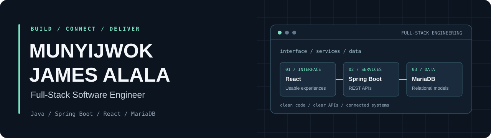

  

  <strong>Full-Stack Software Engineer · Java / Spring Boot · React</strong> 
  Building useful software with clean code and connected systems.

  <a href="mailto:munjijames02@gmail.com">Email</a> ·
  <a href="https://github.com/munji74?tab=repositories">Projects</a> ·
  <a href="https://github.com/munji74?tab=followers">GitHub community</a>

## Software that solves real problems

I'm **Munyijwok James Alala**, a full-stack software engineer working with **Java, Spring Boot, React and relational databases**. I enjoy connecting backend logic with usable interfaces and turning ideas into working applications.

I care about code that is easy to understand, APIs that are clear to work with and software that the next developer can maintain.

> **From the database to the interface.** My focus is on making the pieces work well together.

## Java / Spring Boot is home ground

My backend stack centers on Spring Boot, Spring Security and Hibernate, with MariaDB and MySQL for relational data.

- **Backend development:** Java, Spring Boot and REST APIs for application services and business logic.
- **Application security:** Spring Security for authentication and authorization.
- **Data access:** Hibernate, MariaDB and MySQL for persistence and relational models.
- **Full-stack integration:** Connecting backend services to React applications.

## Full-stack toolkit

| Discipline | Tools and technologies |
| :-- | :-- |
| **Backend** | Java, Spring Boot, Spring Security, Hibernate and REST APIs |
| **Frontend** | React, JavaScript, Tailwind CSS, Vite, HTML and CSS |
| **Databases** | MariaDB and MySQL |
| **Deployment and version control** | Railway, Git and GitHub |

## Where I focus

**Backend APIs.** Building Spring Boot services with clear application logic and security in mind.

**React interfaces.** Creating web experiences with React, Tailwind CSS and Vite, connected to backend APIs.

**Full-stack platforms.** Bringing interfaces, application services and relational data together into a coherent product.

[Explore my repositories →](https://github.com/munji74?tab=repositories)

## GitHub stats

A snapshot of my contributions and coding consistency.

  

## How I like to build

- **Keep the code clear.** Prefer readable solutions and maintainable boundaries.
- **Connect the whole system.** Think through how the interface, API and database work together.
- **Build with care.** Give security, usability and data handling attention throughout development.

---

### Let's build something useful

I'm interested in collaborating on **Spring Boot APIs, React applications and full-stack platforms**. If you're working on something in that space, let's connect.

**[Email me](mailto:munjijames02@gmail.com)** · **[Explore my work](https://github.com/munji74?tab=repositories)**
